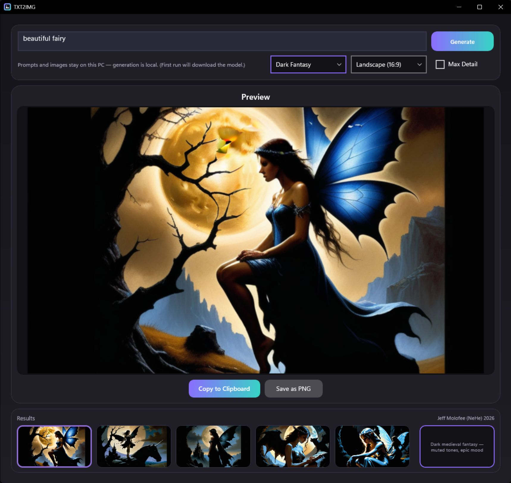

# TXT2IMG

**2026 Jeff Molofee (NeHe)**

A Windows desktop app (WinUI 3) that turns a text prompt into images on your own GPU — with hand-tuned style presets (oil, anime, pixel, cyberpunk, and more), five variations per run, and one-click copy to the clipboard. No account, no API keys; the only network use is the one-time model download.

---

<p align="center"></p>

---

## Download

Grab the latest build from the [Releases page](https://github.com/NeHeGL/TXT2IMG/releases) — download `TXT2IMG-v1.1.2-windows-x64.zip` (or newer), extract anywhere, and run `TXT2IMG.exe`.

If you don't already have it (most Windows 11 PCs do, from other WinUI apps), install the [Windows App SDK Runtime](https://learn.microsoft.com/en-us/windows/apps/windows-app-sdk/downloads) first — a small, one-time Microsoft redistributable, same idea as a VC++ Redistributable.

---

## Features

- **Local generation** — prompts and images stay on your PC; the only network use is the one-time model download on first run
- **DreamShaper XL Lightning only** — one fast, high-quality model (see [Models](#models) for why SDXL Base was dropped)
- **39 style presets** — alphabetized in the dropdown, each with a live description and neighbor-fencing negatives (see [Styles](#styles)). Mix of hand-tuned DreamShaper recipes and StyleSelectorXL templates adapted for Lightning.
- **Aspect ratio picker** — Square, Landscape/Portrait 16:9, Landscape/Portrait 4:3 (defaults to Landscape 16:9)
- **Resolution** — **768** (fast) or **896** (sharper; GPU max). Large GPUs (≥ ~18 GiB dedicated) use a stronger denoise recipe automatically at **896**.
- **4K upscale** — optional CPU resize to 3840 px long edge after each image (preview/save/export; img2img **"New Variation"** still uses native GPU resolution)
- **Generates 5 variations per prompt** so you can pick the best result in one pass
- **"New Variation" button** — img2img tweak of the selected result (same prompt/layout, new details)
- **Model download progress** — first-run download fills the **Generate** button with percent; status text cycles yellow notice → green download message → **"New Variation"** hint; downloads resume if interrupted
- **Copy to clipboard or save as PNG** — save suggests a filename that includes the panel number and style, e.g. `fairy-with-wings-2-icon.png`; PNGs also embed the prompt and style as metadata

---

## Usage

1. Type a prompt and press Enter (or click **Generate**)
2. Pick a **Style** and **Aspect Ratio** — the panel next to the results shows a description of the selected style
3. Pick **Resolution** (**768** or **896**) and optionally **4K upscale** for export size
4. Click any of the 5 results to preview it; use **"New Variation"** on a keeper for another take
5. **Copy to Clipboard** or **Save as PNG**

---

## Styles

The style presets are the heart of this app, and getting them right took the bulk of the development time. A style is not a single keyword bolted onto your prompt — each one is a carefully assembled recipe of positive terms, a tailored **negative** prompt, and per-style tuning (guidance scale, inference steps, and in some cases medium locks and grayscale enforcement). They were built and refined over many rounds of side-by-side generation, comparing the same subject across styles, watching for the specific ways DreamShaper Lightning drifts, and pushing each look back into its own lane.

Most of that work was **differentiation**. Left alone, a small distilled model happily collapses neighboring styles into the same image: Oil Painting slides into Graphic Oil's palette-knife slabs, Cartoon and Anime and Comic Book blur together, flat/vector styles quietly render as photos, and half the palette drifts toward the same "red-and-black poster" look. Every style therefore carries negative-prompt terms aimed squarely at its closest neighbor, so the lineup stays visually distinct:

- **Painterly & traditional media** — **Oil Painting**, **Soft Oil**, **Graphic Oil**, **Watercolor**, **Claymation**, **Cubist**, **Ink Wash**, **Impressionist**, **Pointillism**, **Tribal**, **Zentangle**.
- **Illustration & comics** — **Cartoon**, **Anime**, **Comic Book**, **Concept Art**, **Fantasy Art**, **Dark Fantasy**, **Minimalist**, **Pop Art**, **Line Art**, **Silhouette**.
- **Graphic & digital / craft** — **Colorful Vector**, **Icon**, **Pixel Art**, **3D Render**, **Cyberpunk**, **Futuristic**, **Steampunk**, **Low Poly**, **Minecraft**, **Origami**, **Kirigami**, **Paper Quilling**, **Paper Cut Collage**, **Papercut Shadow Box**, **Stacked Papercut**.
- **Photographic** — **Black & White**, **Vintage Photo**, **Film Noir**.
- **None** — no style suffix at all, letting the model interpret your prompt on its own.

Many of the papercraft / geometric / classic-art presets use [StyleSelectorXL](https://github.com/ahgsql/StyleSelectorXL) prompt templates (with light fences where DreamShaper needed them). Others were built or retuned here for Lightning. Full attribution is in [Credits](#credits).

---

## Models

Runs Stable Diffusion XL locally via [OnnxStack](https://github.com/saluteai/OnnxStack) and ONNX Runtime with DirectML, using **DreamShaper XL Lightning** — distilled for low-step inference — downloaded on first use into `%LocalAppData%\TXT2IMG\Models\`.

**SDXL Base was removed** from the app to keep the download and on-disk footprint smaller. DreamShaper is also the better default for this UI: faster, generally cleaner anatomy, and stronger styled results than the stock SDXL checkpoint was giving us.

---

## Design notes

- **Single centered Preview** — the old side-by-side reference/img2img edit panel (load a photo, restyle or age a face, etc.) was removed because it never worked reliably with DreamShaper Lightning. Generation is text + style; the **"New Variation"** button is a separate, targeted img2img path on a finished result.
- **896** is the safe GPU long-edge cap (1024 repeatedly tripped TDR on DirectML). **4K upscale** is export-only, not extra denoise. Defaults stay safe on ~16 GB VRAM cards; larger cards get a stronger denoise recipe at **896**, not a higher canvas size.

---

## What's new in v1.1.2

- **Resolution picker** — **768** (fast) or **896** (sharper; GPU max).
- **Large-GPU denoise** — cards with enough dedicated VRAM automatically use a stronger step/CFG recipe at **896** (same pixel size).
- **4K upscale** — optional CPU resize to 3840 px long edge after each image for preview/save/clipboard.
- **Added "New Variation" button** — img2img variation of the selected result (same stored prompt/layout, new details).
- **Model download progress** — first-run download fills the **Generate** button with percent; status text cycles yellow notice → green download message → **"New Variation"** hint; downloads resume if interrupted.
- **Blank-image detection** — skips/report empty outputs after generation or variation.

## What's new in v1.1.1

- **More styles** — **Film Noir**, **Impressionist**, **Pointillism**, **Pop Art**, **Steampunk**, plus StyleSelectorXL papercraft / geometric / ink presets (**Cubist**, **Kirigami**, **Line Art**, **Low Poly**, **Minecraft**, **Origami**, **Paper Quilling**, **Paper Cut Collage**, **Papercut Shadow Box**, **Silhouette**, **Stacked Papercut**, **Tribal**, **Zentangle**, **Ink Wash**). See [Styles](#styles).
- **Style recipe tuning** — subject fences where XL templates drifted (e.g. **Tribal** wallpaper-only outputs; **Low Poly** / **Minecraft** multi-subject clutter).
- **Style dropdown** — ComboBox wheel-scroll and top-align polish (one style per notch; opens aligned to the control).

## What's new in v1.1.0

- **Style expansion** — core v1.1.0 styles and first StyleSelectorXL / DreamStudio trial batch. See [Styles](#styles).
- **Retuned existing styles** — **Anime**, **Oil Painting**, **Pixel Art**, **Watercolor**, **Comic Book**, and **Fantasy Art** got stronger recipes and neighbor-fencing negatives. **Dark Fantasy** keeps the older muted fantasy look; **Soft Oil** keeps the gentler former Oil Painting feel; **Graphic Oil** is the hard palette-knife lane.
- **Styles alphabetized** in the dropdown; the selected item no longer gets a competing highlight fill (hover shows what a click will pick).
- **Black & White** enforces grayscale on the output pixels, since the model leaks color from prompts and lighting alone.
- **DreamShaper-only** — SDXL Base / model picker removed; DreamShaper is the sole engine.
- **Reference photo panel removed** — free-form photo edits were unreliable; see [Design notes](#design-notes). (The **"New Variation"** button in v1.1.2 is a different, result-only path.)
- **Photorealistic and Cel-Shaded removed** — Photorealistic overlapped the photo-oriented lanes; Cel-Shaded overlapped Cartoon/Anime and was inconsistent.
- **Seed readout and "keep this + 4 new" variation button removed** — generation still batches 5 varied results per prompt.
- **Layout** — single centered Preview; defaults to Landscape 16:9.
- **Style uniqueness pass** — neighbor-targeted negatives plus an anti "red-and-black poster" collapse.
- **Fixed occasional GPU hang (`DXGI_ERROR_DEVICE_HUNG`) mid-batch** — baseline resolution lowered to 768.
- **Fixed anatomy artifacts** — broader negatives and more inference steps (8 → 12, with a boost on non-square aspects).
- **Fixed non-square aspects reintroducing anatomy/GPU-hang risk** — long edge capped at the model's native resolution.
- **Fixed flat/vector styles occasionally rendering photorealistic** — scoped guidance-scale increase.
- **Style dropdown mouse-wheel scrolling** — one style per notch (workaround for [microsoft-ui-xaml#8764](https://github.com/microsoft/microsoft-ui-xaml/issues/8764)).
- **Fixed result thumbnails / style description overflowing** on Landscape/Portrait.

---

## Requirements

- Windows 10/11 x64 with a DirectX 12 compatible GPU (DirectML)
- [Windows App SDK Runtime](https://learn.microsoft.com/en-us/windows/apps/windows-app-sdk/downloads) 1.7+ (one-time install, see Download above)

---

## Building from source

Requires the [.NET 8 SDK](https://dotnet.microsoft.com/download/dotnet/8.0) with the Windows App SDK workload.

**To produce a distributable `.exe`** (the same self-contained build used for GitHub Releases), run **`build.bat`** from the project root — it publishes a Release, self-contained `win-x64` build to `publish\TXT2IMG.exe`.

**For development** (debugging in Visual Studio), open `TXT2IMG.csproj`, or from a terminal:

```bat
dotnet build TXT2IMG.csproj
```

It targets `net8.0-windows10.0.19041.0` with WinUI 3.

---

## Project layout

- [Program.cs](Program.cs) / [App.xaml](App.xaml) / [App.xaml.cs](App.xaml.cs) — application entry point and Windows App SDK bootstrap
- [MainWindow.xaml](MainWindow.xaml) / [MainWindow.xaml.cs](MainWindow.xaml.cs) — main UI and generation flow
- [StylePromptBuilder.cs](StylePromptBuilder.cs) — style presets, positive/negative prompts, and per-style tuning
- [LocalImageGenerator.cs](LocalImageGenerator.cs) — OnnxStack pipeline wrapper (txt2img + img2img variation)
- [ModelDownloader.cs](ModelDownloader.cs) — model catalog and on-demand download
- [GenerationProfile.cs](GenerationProfile.cs) / [HardwareBudget.cs](HardwareBudget.cs) / [GpuCapabilitiesProbe.cs](GpuCapabilitiesProbe.cs) — resolution tiers and VRAM-safe caps (keeps defaults safe on ~16 GB cards)
- [ImageUpscale.cs](ImageUpscale.cs) — optional 4K long-edge CPU resize
- [PngSanity.cs](PngSanity.cs) — blank-image detection and PNG size helpers
- [ExecutionProviders.cs](ExecutionProviders.cs) — DirectML/CPU execution provider setup
- [PngGrayscale.cs](PngGrayscale.cs) / [PngTextChunk.cs](PngTextChunk.cs) — B&W pixel enforcement and PNG metadata helpers
- [CrashLog.cs](CrashLog.cs) — fatal-error logging
- [build.bat](build.bat) — Release publish to `publish\TXT2IMG.exe`

---

## Author

2026 Jeff Molofee (NeHe)

---

## Credits

The checkpoint and runtime are covered under [Models](#models). Most styles were built and tuned here. A few newer presets (and some later retunes) used published prompt guides as a starting point, then were adapted for DreamShaper XL Lightning (retuned positives/negatives, adjusted guidance and steps, no LoRAs). Thanks to:

- [InsiderLLM — AI Art Styles & Workflows](https://insiderllm.com/guides/ai-art-styles-workflows-guide/) — starting recipes for the new **Concept Art** and **Minimalist** presets. Prompt language from the same guide also informed later retunes of styles that were already in the app (**Anime**, **Oil Painting**, **Pixel Art**, **Watercolor**, **Comic Book**, **Fantasy Art**).
- [Stable Diffusion Art — SDXL prompts](https://stable-diffusion-art.com/sdxl-prompts/) — the basis for **Colorful Vector** (effect #11 "Fish," made subject-agnostic) and **Cyberpunk**.
- [StyleSelectorXL](https://github.com/ahgsql/StyleSelectorXL) / [twri/sdxl_prompt_styler](https://github.com/twri/sdxl_prompt_styler) — `{prompt}` templates for many papercraft, geometric, and classic-art presets (**Pop Art**, **Pointillism**, **Impressionist**, **Film Noir**, **Steampunk**, **Tribal**, **Zentangle**, papercuts, **Low Poly**, **Minecraft**, and related). Adapted and fenced for DreamShaper XL Lightning where needed.

Everything else in the lineup — including **Cartoon**, **Icon**, **Claymation**, **3D Render**, **Dark Fantasy**, **Futuristic**, **Graphic Oil**, **Soft Oil**, **Black & White**, **Vintage Photo**, and **Ink Wash** — is original tuning for this app. All recipes were reworked to hit their intended look on this model without LoRAs, and every style was tuned against its neighbors so the lineup stays distinct.
